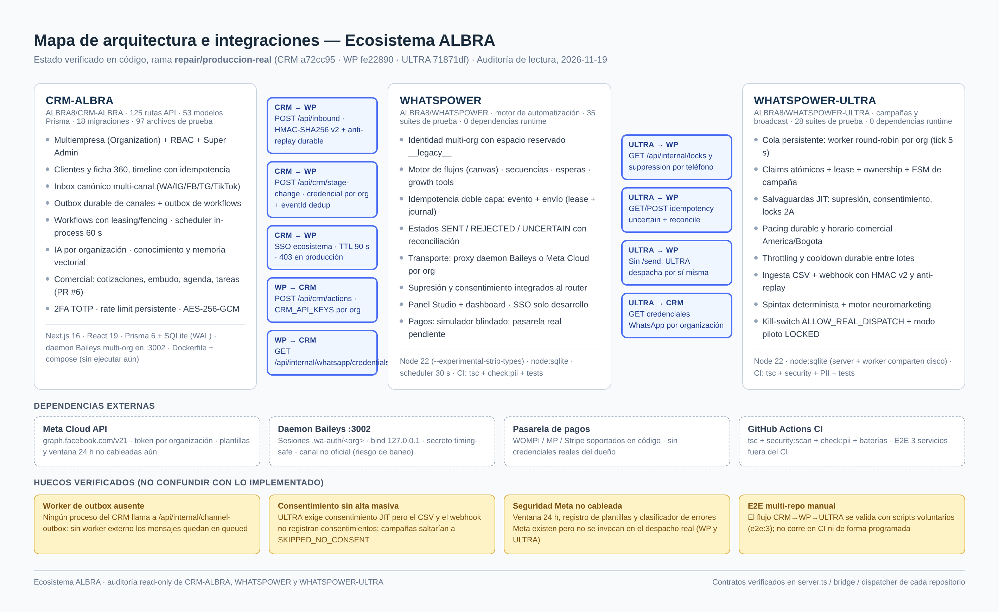
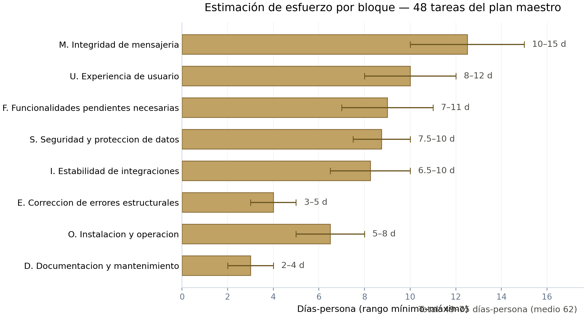

# Plan maestro de cierre integral de ALBRA

**Diagnóstico con evidencia de los tres componentes y ruta hacia producción**

| | |
|---|---|
| Alcance | CRM-ALBRA · WHATSPOWER · WHATSPOWER-ULTRA |
| Referencia externa | cuentas-Ailink/crm-whatsapp-ia (solo lectura) |
| Base auditada | `repair/produccion-real` en los tres repositorios |
| Fecha | 19 de noviembre de 2026 |
| Fase | Diagnóstico y planificación — **sin programación** (congelación de implementaciones) |
| Versión | v1.0 · Documento de planificación del ecosistema ALBRA |

**Paquete completo de este plan (misma carpeta):**

- [Plan-Maestro-Cierre-Integral-ALBRA.pdf](Plan-Maestro-Cierre-Integral-ALBRA.pdf) — documento oficial con figuras
- [Plan-Maestro-Cierre-Integral-ALBRA.docx](Plan-Maestro-Cierre-Integral-ALBRA.docx) — versión editable
- [Plan-Maestro-ALBRA-Matriz-de-Tareas.xlsx](Plan-Maestro-ALBRA-Matriz-de-Tareas.xlsx) — las 48 tareas con sus 12 campos completos (aceptación, cierre, riesgos, pruebas), más hojas Resumen, Decisiones y Criterios
- [mapa-arquitectura-albra.png](mapa-arquitectura-albra.png) y [esfuerzo-bloques-albra.png](esfuerzo-bloques-albra.png) — figuras

---

## Tabla de contenido

1. [Resumen ejecutivo](#1-resumen-ejecutivo)
2. [Alcance, método y límites de la auditoría](#2-alcance-método-y-límites-de-la-auditoría)
3. [Estado real de los repositorios y sus ramas](#3-estado-real-de-los-repositorios-y-sus-ramas)
4. [Mapa de arquitectura e integraciones](#4-mapa-de-arquitectura-e-integraciones)
5. [Inventario técnico de los tres componentes](#5-inventario-técnico-de-los-tres-componentes)
6. [Comparación completa con el CRM de referencia](#6-comparación-completa-con-el-crm-de-referencia)
7. [Funcionalidades existentes que deben conservarse](#7-funcionalidades-existentes-que-deben-conservarse)
8. [Funcionalidades duplicadas o desconectadas](#8-funcionalidades-duplicadas-o-desconectadas)
9. [Brechas reales y riesgos priorizados](#9-brechas-reales-y-riesgos-priorizados)
10. [Auditoría independiente de los PR #5 y #6](#10-auditoría-independiente-de-los-pr-5-y-6)
11. [Plan maestro priorizado (48 tareas en 8 bloques)](#11-plan-maestro-priorizado-48-tareas-en-8-bloques)
12. [Dependencias entre tareas](#12-dependencias-entre-tareas)
13. [Criterios de aceptación y cierre por tarea](#13-criterios-de-aceptación-y-cierre-por-tarea)
14. [Criterios globales para declarar ALBRA terminado](#14-criterios-globales-para-declarar-albra-terminado)
15. [Estimación de esfuerzo por bloque y supuestos](#15-estimación-de-esfuerzo-por-bloque-y-supuestos)
16. [Decisiones que requieren autorización del propietario](#16-decisiones-que-requieren-autorización-del-propietario)

---

## 1. Resumen ejecutivo

Esta auditoría evaluó los tres componentes del ecosistema ALBRA (CRM-ALBRA, WHATSPOWER y WHATSPOWER-ULTRA) leyendo su código real, su historial git, sus migraciones, sus pruebas y sus ejecuciones de CI en GitHub, más el CRM de referencia externo crm-whatsapp-ia usado exclusivamente como referencia de experiencia. La rama de integración correcta sigue siendo `repair/produccion-real` en los tres repositorios, con tips a72cc95 (CRM), fe22890 (WHATSPOWER) y 71871df (ULTRA). El árbol local está limpio y sincronizado con el remoto, y durante toda la fase no se modificó ningún archivo, rama ni PR.

La conclusión central es positiva: **ALBRA no necesita reconstruirse**. El CRM es un sistema SaaS multiempresa maduro (125 rutas API, 53 modelos Prisma, 18 migraciones, 97 archivos de prueba) con aislamiento por organización probado, outbox durable, idempotencia de webhooks y scheduler con fencing real. WHATSPOWER y ULTRA tienen motores sólidos, con doble capa de idempotencia de envío, estados SENT/REJECTED/UNCERTAIN reconciliables y salvaguardas de consentimiento y supresión integradas al camino crítico. La brecha hacia producción no es de potencia sino de **cableado, despliegue y honestidad documental**.

Se identificaron cuatro huecos operativos que impiden declarar el sistema listo: primero, la outbox de canales del CRM no tiene worker en el despliegue, de modo que sin un proceso externo los mensajes quedan encolados indefinidamente; segundo, ULTRA exige consentimiento por contacto pero no ofrece vía de alta masiva, lo que bloquea cualquier campaña real; tercero, la ventana de 24 horas, el registro de plantillas y el clasificador de errores de Meta están implementados pero no cableados al despacho en WP y ULTRA; cuarto, el E2E de los tres servicios existe pero corre fuera del CI de forma voluntaria. A ello se suman hallazgos de seguridad gestionables (82 secretos históricos pendientes de rotación y purga, secreto operador global en WP) y divergencias entre documentos y código que crean falsa confianza de cierre.

En cuanto a los PR congelados: el **PR #6** (tareas y quick-actions en la ficha 360) está en verde de CI y es integrable tras resolver la numeración de migraciones; el **PR #5** (limpieza de deuda y backfill de QuoteItem) tiene el CI en rojo en el paso *Suite de tests* según la evidencia de terceros de GitHub Actions, lo que contradice el mensaje de su commit que reclama una batería 784/784 en verde; **no debe fusionarse hasta diagnosticar el fallo**. El plan maestro resultante organiza **48 tareas en 8 bloques**, con una estimación de 49 a 75 días-persona (medio 62), y termina con la lista de **14 decisiones** que requieren autorización expresa del propietario.

## 2. Alcance, método y límites de la auditoría

El alcance cubre exclusivamente los repositorios ALBRA8/CRM-ALBRA, ALBRA8/WHATSPOWER y ALBRA8/WHATSPOWER-ULTRA, más el repositorio de referencia cuentas-Ailink/crm-whatsapp-ia como material de comparación. No se tocó ningún repositorio: no hubo commits, ramas nuevas, PRs, migraciones, despliegues ni envíos reales. Las únicas operaciones contra los clones locales fueron de lectura y de actualización de referencias remotas (git fetch de refs de tracking, que no altera el árbol de trabajo).

El método combinó cuatro fuentes verificables: lectura directa de código fuente con citas de ruta y símbolo; comandos git de lectura (log, show, diff, grep sobre árboles concretos, incluidos los árboles de ramas remotas sin fusionar); la API de GitHub para el estado de PRs y de GitHub Actions — sin autenticación en la fase de diagnóstico y con API autenticada en la sesión de publicación de este documento — que constituye evidencia de terceros; y auditorías estructuradas por componente con clasificación honesta por módulo. Cada afirmación del informe se etiqueta mentalmente en tres categorías: **verificado** (leído directamente en esta auditoría), **inferido** (deducción razonada de evidencia parcial) y **no encontrado o no verificable**, que se declara expresamente.

Los límites se declaran sin rodeos. Esta sesión no ejecutó ninguna batería de pruebas del producto por la orden de congelación: todas las cifras de suites verdes provienen del CI de GitHub (tercero) o de informes de sesiones anteriores identificados como tales. El log completo del CI fallido del PR #5 no se descargó en la fase de diagnóstico; en la sesión de publicación, con la API autenticada, se identificó el paso que falla (*Suite de tests*, job 135240625938, con migraciones limpias, TypeScript, lint y escáneres en verde — véase §10.1), pero la **causa raíz de los tests sigue sin determinar** hasta ejecutar la batería. No fue posible verificar Docker (el entorno de trabajo no tiene Docker instalado y los compose jamás se ejecutaron según el propio OWNER_TODO), ni sesiones reales de WhatsApp, ni los repos receptores del SSO fuera de los tres auditados. Ningún número de teléfono real, secreto ni pepper fue impreso o comprometido.

## 3. Estado real de los repositorios y sus ramas

Los tres repositorios comparten la misma rama de integración `repair/produccion-real`, que concentra las olas de reparación 2026-11. La rama `main` de cada repositorio está detrás de ella (29 commits en CRM, 11 en WP, 16 en ULTRA) y no contiene commits únicos, es decir, no hay trabajo en main que se pierda: fusionar `repair/produccion-real` hacia `main` es avanzar en línea recta. La topología completa de 21, 11 y 13 ramas remotas respectivamente fue mapeada contra la base; la mayoría de ramas fix/ e impl/ históricas están ya contenidas en la base (ahead=0).

**Tabla 1: Estado verificado de los tres repositorios (2026-11-19)**

| Repositorio | Rama base | Tip | CI más reciente (tercero) | Clon local |
|---|---|---|---|---|
| CRM-ALBRA | `repair/produccion-real` | a72cc95 | success en dfd926a (rama del PR #6); failure en 1e5c9ae (rama del PR #5) | limpio, en la rama del PR #6 |
| WHATSPOWER | `repair/produccion-real` | fe22890 | success en fe22890 (2026-11-18) | limpio, en la rama base |
| WHATSPOWER-ULTRA | `repair/produccion-real` | 71871df | success en 71871df (2026-11-18) | limpio, en la rama base |

Además de los dos PR congelados, existe trabajo no fusionado relevante que la auditoría examinó commit a commit. En el CRM hay un **PR #4** abierto hacia `main` con una prueba del agujero de ACK ambiguo de la outbox de workflows (usa un trigger SQLite que aborta la persistencia para simular que el proveedor aceptó el envío pero la base no pudo registrar el ACK), una rama con pruebas multiproceso del scheduler con lease, y una rama de reorganización documental. En WHATSPOWER hay una rama solo-documental que describe el contrato de credenciales con ULTRA y una rama divergida de 953 líneas superpuesta con una solución ya fusionada. En ULTRA hay un fix importante no fusionado: smoke-live.mjs dejaba de borrar por prefijo SMOKE-, pudiendo eliminar campañas ajenas, corregido en la rama `impl/fix-funcionales-20261112`.

**Tabla 2: Ramas con trabajo no fusionado (diff contra `repair/produccion-real`)**

| Repo | Rama | Commits | Contenido verificado | Riesgo de fusión |
|---|---|---|---|---|
| CRM | `cierre/a-estabilizacion-y-deuda` (PR #5) | 2 | Eliminación de dependencias y componentes muertos + backfill de QuoteItem (migración 10_) | ALTO: CI rojo en Suite de tests |
| CRM | `cierre/c-tareas-y-acciones-ficha` (PR #6) | 1 | Módulo de tareas y recordatorios + quick-actions reales en ficha 360 | MEDIO: CI verde; numeración de migraciones |
| CRM | `test/workflow-outbox-ambiguous-ack` (PR #4) | 5 | Prueba de ACK ambiguo con trigger SQLite; abierta hacia main | BAJO |
| CRM | `fix/migration-safety-audit` | 11 | Pruebas multiproceso del scheduler (lease entre procesos) | BAJO |
| CRM | `docs/context-crm-reorganization-20261107` | 25 | Reorganización de la base de conocimiento CONTEXTO CRM | BAJO |
| WP | `impl/fix-funcionales-20261112` | 2 | Solo documentación del contrato ULTRA (credenciales por org) | BAJO: fusionable tal cual |
| WP | `fix/fase-correctiva-final` | 3 | JournaledEffect por efecto, 953 líneas sobre router/server/db | ALTO: superpuesto con la solución B2 ya fusionada |
| ULTRA | `impl/fix-funcionales-20261112` | 4 | Fix del borrado destructivo de smoke-live por prefijo + docs | BAJO: fusionable |
| ULTRA | `fix/fase2-seguridad-ultra` | 12 | Endurecimiento del escáner de secretos (baseline, allowlist) | ALTO: choca con el denylist HMAC+pepper ya fusionado |
| ULTRA | `fix/fase-correctiva-final` | 4 | organization_id por fila (ya existe en base) + AGENTIC_2A_KEYS (nuevo) | MEDIO: parcialmente duplicado |

## 4. Mapa de arquitectura e integraciones

El ecosistema es una arquitectura de tres motores con contratos explícitos. **CRM-ALBRA** es la aplicación multiempresa donde viven los usuarios, los clientes, la ficha 360, la bandeja canónica y la lógica comercial; orquesta a WHATSPOWER mediante webhooks firmados y credenciales de servicio por organización. **WHATSPOWER** es el motor de automatización de WhatsApp (flujos visuales, secuencias, growth tools) con identidad multiorganización e idempotencia de doble capa. **WHATSPOWER-ULTRA** es el motor de campañas masivas con salvaguardas obligatorias en el camino crítico, que consulta a WHATSPOWER los locks y la supresión de cada teléfono pero despacha por sí mismo hacia el daemon Baileys del CRM o hacia Meta Cloud API con credenciales por organización.

*Figura 1: Mapa de arquitectura e integraciones del ecosistema ALBRA (estado verificado).*

La tabla siguiente consolida los contratos verificados en código. Todos los puentes usan autenticación por organización con eco obligatorio del organizationId en la respuesta, para que el consumidor valide que el proveedor operó sobre la organización correcta. El SSO del ecosistema existe en los tres repositorios pero está bloqueado deliberadamente en producción (403) y su token de un solo uso vive en memoria de proceso, lo que exige la tarea I2 de prueba de compatibilidad.

**Tabla 3: Contratos del ecosistema verificados en código**

| Sentido | Endpoint y método | Autenticación | Evidencia (archivo) |
|---|---|---|---|
| CRM → WP | POST /api/inbound (auto-respuesta) | HMAC-SHA256 v2 con timestamp y anti-replay durable; el secreto vincula la organización | src/lib/whatspower-bridge.ts (CRM); server.ts y engine/router.ts (WP) |
| CRM → WP | POST /api/crm/stage-change | X-Org-Id + credencial de servicio por organización; eventId determinista con ventana de 5 minutos | whatspower-bridge.ts (deriveStageEventId) |
| WP → CRM | POST /api/crm/actions | CRM_API_KEYS por organización con eco organizationId (TENANT_UNVERIFIED en desvío) | src/adapters/crm-client.ts (WP) |
| WP → CRM | GET /api/internal/whatsapp/credentials | CRM_INTERNAL_CREDENTIAL | src/adapters/crm-client.ts (WP); src/org-wa-credentials.ts (ULTRA) |
| ULTRA → WP | GET /api/internal/locks/:phone | Credencial por organización + eco organizationId; fail-closed | src/safety/lock-checker.ts (ULTRA) |
| ULTRA → WP | GET /api/internal/suppression/:phone | Ídem; revoca consentimiento al suprimir | src/safety/suppression.ts (ULTRA) |
| ULTRA → WP | GET/POST /api/internal/idempotency/uncertain y reconcile | Credencial por organización; confirmResend exige evidencia de 16+ caracteres | src/server.ts (WP, reconcileEvent) |
| ULTRA → Daemon | POST /send vía proxy del daemon | INTERNAL_API_SECRET + X-Org-Id; kill-switch ALLOW_REAL_DISPATCH | src/adapters/dispatcher.ts (ULTRA) |
| ULTRA → Meta | POST graph.facebook.com/v21/{phoneId}/messages | Token Meta por organización (no cifrado en reposo) | src/adapters/meta-cloud-dispatcher.ts (ULTRA) |
| CRM → WP (SSO) | GET /api/auth/ecosystem/links → /studio/login-ecosystem | ECOSYSTEM_SSO_SECRET; TTL 90 s, jti de un solo uso; 403 en producción | src/lib/ecosystem-sso.ts (los 3 repos) |

## 5. Inventario técnico de los tres componentes

El inventario clasifica cada módulo en las siete categorías acordadas: **1** existe y funciona según evidencia; **2** existe pero necesita correcciones; **3** existe parcialmente; **4** duplicado; **5** documentado pero no implementado; **6** no existe; **7** no se puede confirmar con la evidencia disponible. Ningún módulo se marcó como terminado solo por existir una ruta o un modelo: la categoría 1 exige además pruebas que la respalden (propias del repositorio o de CI). Las tablas resumen los hallazgos por componente; la matriz completa con las 48 tareas derivadas se entrega en el [libro Excel](Plan-Maestro-ALBRA-Matriz-de-Tareas.xlsx).

### 5.1 CRM-ALBRA

**Tabla 4: Inventario CRM-ALBRA (base a72cc95 + PR #6 no fusionado)**

| Módulo | Cat. | Evidencia principal |
|---|---|---|
| Autenticación, sesiones y 2FA | 1 | auth.ts con JWT HS256 sin fallback, tokenVersion persistente consultada por request; TOTP con anti-replay; 12 rutas auth; tests de revocación multi-instancia |
| Multiempresa y permisos | 1 | organizationId en los WHERE de las APIs revisadas; requireSuperAdmin como única puerta cruzada; RBAC con comodines; tests tenant-route-hardening (22 casos) y cross-org-references |
| Clientes y ficha 360 | 1 | APIs clients, history y preferences; timeline unificado con sourceEventKey UNIQUE por organización (P2002 absorbido); quick-actions reales vía PR #6 |
| Inbox canónico multi-canal | 2 | inbox.ts unifica tres fuentes (daemon legacy, TimelineEvent y modelo canónico ChannelConversation/Message); dos generaciones de modelo conviven y un contacto puede aparecer dos veces |
| WhatsApp QR (Baileys) | 1 | Un único daemon (src/whatsapp-daemon/daemon.mjs) multi-org con sesiones .wa-auth/<org>, bind 127.0.0.1, secreto timing-safe; envío sin orgId solo con 1 sesión, 409 con 2 o más |
| Otros canales (IG, FB, TG, TikTok) | 1 | Webhooks con firma verificada, OAuth con aislamiento de tenant, rotación de token TikTok con lease fail-closed (migración zzzzz) |
| Outbox durable de canales | 2 | channel-outbox.ts con intent→claim→dispatch→sent/failed/unknown; unknown jamás reintentado y conciliación exige providerChecked; **el worker que procesa la cola NO forma parte del despliegue** |
| Outbox de workflows | 1 | workflow-outbox.ts con dispatcher con lease y recuperación; PR #4 añade prueba de ACK ambiguo |
| Idempotencia de webhooks | 1 | ChannelWebhookEvent con attemptCount y claimToken; fencing anti-handler-stale (migraciones z_ y zzzz_) |
| Workflows y scheduler | 1 | leaseToken + fencingVersion monotónico con CAS updateMany; recuperación conservadora que nunca re-ejecuta pasos ambiguos; scheduler in-process cada 60 s |
| IA por organización | 1 | ai.ts con proveedor por org compatible OpenAI y fallback z-ai-web-dev-sdk; knowledge y memoria con embeddings; MCP con API keys albra_ solo-hash |
| Comercial (embudo, cotizaciones, agenda) | 1 | Numeración de cotizaciones UNIQUE(org, number) como guardia final; tests de concurrencia; reportes PDF/Excel |
| Tareas y recordatorios | 1* | PR #6 no fusionado: migración 11_tareas, API org-scoped, tarjeta en el dashboard y tests de integración (109 líneas); CI verde en su rama |
| Seguridad transversal | 1 | Rate limit doble capa (memoria best-effort + BD con UPDATE RETURNING); AES-256-GCM para credenciales; api-keys solo-hash; escáneres de secretos y PII en CI |
| Operación (Docker, backups, doctor) | 2 | Dockerfile multi-stage y compose correctos en papel pero jamás ejecutados; backup con Online Backup API + integrity_check y drill; /api/doctor aislado por org sin pantalla propia |

### 5.2 WHATSPOWER

**Tabla 5: Inventario WHATSPOWER (base fe22890)**

| Módulo | Cat. | Evidencia principal |
|---|---|---|
| Servidor y puertas de acceso | 1 | server.ts con productionConfigProblems que bloquea arranque en producción sin secretos fuertes; cookie Studio HMAC HttpOnly; denylist de valores débiles |
| Identidad multi-organización | 1 | Claves compuestas (organization_id) en 20+ tablas; espacio `__legacy__` reservado y rechazado como identidad en 7 puntos; la org del inbound la fija el secreto, no el body |
| Motor de flujos y secuencias | 1 | flow-engine con nodos keywords, media, botones, HSM, wait, AI y handoff; sequence-runner y flow-wait-runner con suite dedicada; growth tools con /ref/:slug |
| Idempotencia de envío | 1 | idempotency_keys con reserva atómica y lease 120 s; daemon_send_idempotency con IN_FLIGHT antes de llamar al proveedor; UNCERTAIN jamás re-ejecutado sin confirmResend con evidencia |
| Clasificación de resultados | 2 | 2xx legible→SENT; 4xx/429→REJECTED; 408/425/5xx/timeout→UNCERTAIN; el clasificador semántico de errores Meta (131047, 131048, 132000...) existe pero **NO se invoca en el envío real** |
| Transportes | 2 | Proxy Baileys y Meta Cloud por organización funcionan; el selector de transporte por plan (transport-selector.ts) no está cableado: la elección es la variable global TRANSPORT |
| Supresión y consentimiento | 1 | SuppressionStore y ConsentStore integrados al router y al scheduler; tests fase2-consent-compliance |
| Ventana 24 h y plantillas | 3 | MessagingWindowStore y TemplateRegistry modelados y probados aislados pero no invocados en el camino de envío; la matriz interna los declara LISTO, lo cual es exagerado |
| Panel Studio y dashboard | 2 | Studio con canvas probado y login por cookie; API del dashboard protegida por org; la SPA servida es inerte y el ws-server es código muerto (no se instancia) |
| Pagos | 2 | Simulador bien blindado (bloqueado en producción salvo override explícito); pasarela real requiere credenciales del dueño (WOMPI/MP/Stripe) |
| SSO del ecosistema | 1 | ecosystem-sso.ts solo desarrollo: 403 en producción y el secreto en producción bloquea el arranque |

### 5.3 WHATSPOWER-ULTRA

**Tabla 6: Inventario WHATSPOWER-ULTRA (base 71871df)**

| Módulo | Cat. | Evidencia principal |
|---|---|---|
| Cola y worker persistente | 1 | broadcast-worker con claim atómico PENDING→DISPATCHING, lease renovado cada 60 s, reconcile de claims mayores a 900 s y recoverFromCrash al arranque; round-robin por organización |
| FSM de campañas | 1 | DRAFT→RUNNING→PAUSED_*→COMPLETED/CANCELLED con transiciones condicionales; estados terminales que jamás resucitan |
| Salvaguardas JIT obligatorias | 1 | Supresión, consentimiento y locks 2A consultados justo antes de despachar y fail-closed; pacing durable con mínimo 15 s por organización; horario comercial America/Bogota |
| Consentimiento con alta masiva | 6 | El pipeline exige consent_records activo pero ni el CSV ni el webhook registran consentimientos y requireConsentOrigin no se usa en código productivo: **bloqueante operativo y legal** |
| Ventana 24 h y plantillas | 3 | Igual que en WP: definidas y probadas aisladas, nunca invocadas en processNextItem ni en los dispatchers |
| Dispatcher Meta Cloud por organización | 1 | meta-cloud-dispatcher con credenciales por org desde ENV o CRM, caché TTL 5 min, estados REJECTABLE vs uncertain |
| Clasificador de errores Meta | 3 | meta-error-classifier implementado y probado pero no invocado por el dispatcher |
| Pacing y horario en el server | 2 | El worker respeta el pacing durable; el engine del server (/step manual) se construye sin durablePacing y puede despachar sin ritmo |
| Ingesta de audiencias | 2 | Webhook con HMAC v2 y anti-replay durable con binding cross-org rechazado; el importador CSV canoniza E.164 y deduplica pero no exige ni registra consentimiento |
| Paneles (Studio y SPA) | 1 | studio + SPA vanilla servida con API autenticada; /api/health público con solo contadores agregados; login-demo 403 en producción |
| Backup y restauración | 3 | backup-db.ts (VACUUM INTO + integrity_check + swap atómico) y restore-db.ts existen y son razonables, sin test automatizado que los respalde |
| Modo piloto | 1 | pilot-config LOCKED (authorized:false) con gates en cascada y restauración de salvaguarda en finally; kill-switch ALLOW_REAL_DISPATCH físico |

## 6. Comparación completa con el CRM de referencia

La referencia crm-whatsapp-ia (v1.0.2, 3 commits, Next.js 16 + PGlite/Supabase) es deliberadamente monousuario y mononegocio: no existe organization_id en su esquema, no hay tabla de usuarios ni roles, y el modo local carece de autenticación real (cualquier proceso local puede leer /api/leads con todos los teléfonos y conversaciones). Su arquitectura de datos y su seguridad **NO son replicables** para un CRM multiempresa. Su valor está en otro plano: instalación guiada, diagnóstico como producto, catálogo de errores accionables y disciplina de pruebas, donde es superior a lo que ALBRA ofrece hoy al usuario final.

**Tabla 7: Comparación por dimensión (referencia vs ALBRA)**

| Dimensión | Qué hace mejor la referencia | Qué hace mejor ALBRA | Decisión para el plan |
|---|---|---|---|
| Experiencia de usuario | Cuatro secciones planas (Hoy/Clientes/Agenda/Ajustes), paradigma "Te toca" con motivos accionables, ficha con entrega por mensaje, sonidos y contadores en vivo | Funcionalidad mucho mayor (embudo, cotizaciones, canales múltiples, super admin) con RBAC | Adoptar patrones de presentación (U1-U5) sin reducir capacidad |
| Navegación y móviles | Navegación en la URL, sidebar con hoja móvil con objetivos de 48 px para el dedo | 17 páginas con duplicidad de bandejas y ajustes saturados (14 tabs) | Reorganizar a 5+1 secciones; una sola bandeja |
| Instalación y operación | Instalador de un comando idempotente que preserva datos; puesta en marcha de 4 pasos con validación real de claves; comprobar.sh con OK/AVISO/ERROR y botón "Arreglar"; copias diarias | Dockerfile y compose correctos en papel pero jamás ejecutados; doctor potente sin pantalla; sin wizard | Adoptar installer idempotente, pantalla Salud y onboarding (F5, O3) |
| Mensajes de error | Catálogo único codigo/titulo/solucion/paso; invariante que prohíbe nombrar archivos o comandos en la UI | Errores técnicos correctos pero orientados a desarrollador | Catálogo central U3 con test de invariantes |
| Arquitectura de mensajería | Simplicidad total pero respuestas en memoria y sin outbox durable: una caída pierde la respuesta en vuelo | Outbox durable, idempotencia de doble capa, estados UNCERTAIN reconciliables, anti-replay durable | Conservar la arquitectura ALBRA; no copiar la de la referencia |
| Reglas de negocio e IA | Reglas decididas por código y nunca por el prompt; prueba del asistente sin enviar ni guardar, con coste visible; entrada unificada producción/prueba | Agente por org con knowledge y memoria, pero sin modo de prueba de punta a punta | Adoptar modo prueba (F5/U6) y el principio "código decide" |
| Seguridad | Ingeniería cuidada para una persona, pero single-tenant, sin roles, con rate limit solo en memoria y tokens en claro | Multi-org probada, 2FA, revocación persistente, cifrado AES-GCM de credenciales, escáneres en CI | Conservar seguridad ALBRA; cerrar huecos propios (S3, S4, S7) |
| Disciplina de pruebas | 58 archivos con golden e invariantes que escanean el código fuente (prohíbe env en módulos puros, claves en respuestas, textos que revelan archivos) | 97 archivos de integración sólidos pero sin invariantes ni golden del agente | Adoptar invariantes estructurales como test (D4) |
| WhatsApp | Cloud API oficial como vía principal con plantillas gestionadas desde Conexiones; Baileys solo como modo prueba local | Baileys como canal principal (riesgo de baneo reconocido) y Cloud API por org ya implementada | Decisión del dueño sobre estrategia de canal (D3); wiring Meta (M3) |

**Conclusión de la comparación:** la diferencia de naturaleza es que la referencia no es SaaS y ALBRA ya lo es. La brecha de ALBRA no es de capacidad sino de presentación, onboarding y auto-diagnóstico. De la referencia se adoptan ocho prácticas concretas con su evidencia (diagnóstico como producto con autorreparación, catálogo de errores accionables, reglas en código, buzón con debounce y cancelación, agenda de huecos pura compartida, modo prueba E2E sin Meta, semillas deterministas por sector y onboarding con pasos que se marcan solos), y se rechazan explícitamente su modelo single-tenant, su estado en globalThis, su falta de outbox durable y su rate limit en memoria.

## 7. Funcionalidades existentes que deben conservarse

El inventario identifica un núcleo maduro que **ninguna tarea del plan reconstruye, duplica ni reemplaza**. En CRM-ALBRA: el modelo multiempresa con RBAC y super admin; la ficha 360 con timeline idempotente; la outbox durable con conciliación de inciertos; el ledger de webhooks con fencing; el scheduler con lease y fencingVersion; el daemon Baileys multiorganización con sesiones por org y veredicto fail-closed; la autenticación con revocación persistente y 2FA; el cifrado de credenciales con AES-256-GCM; los backups con Online Backup API y drill; y la batería de 97 archivos de prueba.

En WHATSPOWER: la identidad multiorganización con espacio `__legacy__` rechazado en siete puntos; la doble capa de idempotencia de envío con journal de efectos; el motor de flujos y secuencias con suite dedicada; la supresión y el consentimiento integrados al router; y el guard de arranque en producción. En ULTRA: la cola con claims atómicos y lease, la FSM de campañas sin resurrección de estados terminales, las salvaguardas JIT fail-closed, el pacing durable por organización, la ingesta webhook con anti-replay durable, el kill-switch ALLOW_REAL_DISPATCH y el modo piloto bloqueado por diseño. Los contratos entre componentes (Tabla 3) también se conservan tal cual: ninguna tarea del plan cambia una firma o un secreto sin un PR de contrato explícito.

## 8. Funcionalidades duplicadas o desconectadas

Se auditaron expresamente los elementos duplicados, muertos o desconectados, porque son el origen de los parches repetidos y de la falsa sensación de funcionalidad. La regla del plan es doble: **nada se elimina sin autorización explícita del propietario, y nada se reconstruye sin antes decidir cuál de las implementaciones existentes prevalece.**

**Tabla 8: Duplicaciones, código muerto y módulos desconectados**

| Elemento | Tipo | Evidencia | Recomendación |
|---|---|---|---|
| Dos generaciones de inbox en CRM (tablas WhatsApp* legacy vs Channel* canónico) | Duplicado | inbox.ts prioriza el daemon sobre el timeline para el mismo teléfono; migraciones 6-8; un contacto puede aparecer dos veces | Convergencia planificada al modelo canónico con criterio de unificación documentado (M7), sin borrar datos |
| Dos outboxes en CRM (canales y workflows) | Duplicado deliberado | channel-outbox.ts y workflow-outbox.ts con claim y unknown equivalentes | Consolidar el mecanismo común en una utilidad probada; mantener los dos dominios |
| whatsapp-daemon-supervisor.ts | Desconectado | 172 líneas sin ninguna referencia en archivos trackeados (git grep vacío) | Eliminar en un PR de deuda (E3) con autorización |
| ws-server de WHATSPOWER | Desconectado | MiniWebSocketServer no se instancia en server.ts; contadores realtime a 0 | Decidir: cablear o eliminar (E5) |
| Dashboard SPA servida por WP | Desconectado | La SPA servida no consume datos; el panel real vive en el CRM | Documentar alcance real en RUNBOOK (D1/E5) |
| Dependencias muertas del CRM | Duplicado/muerto | next-auth, @hapi/boom y @mdxeditor sin imports en src; js-yaml solo usada por un script | Completar la limpieza iniciada en el PR #5 (E3) |
| Selector de transporte, ventana 24 h, plantillas y clasificador Meta (WP y ULTRA) | Desconectado | Implementados y probados aislados; sin invocación en el despacho real | Cablear al pipeline (M3, I6); la matriz que los declara LISTO debe corregirse (E4/docs) |
| ecosystem-sso.ts espejado en 3 repos | Duplicado por diseño | Mismo módulo copiado con comentario de espejo | Prueba de compatibilidad cross-repo (I2) y archivo canónico |
| Aproximadamente 35 scripts e2e-* históricos del CRM | Desconectado | Rutas de otra máquina y secretos literales; el flujo oficial es scripts/e2e-3-servicios.mjs | Saneamiento S6 (migrar o archivar) con autorización |
| Doble bandeja /whatsapp y /inbox | Duplicado UX | Páginas separadas sin filtros por cuenta en la canónica | Unificar en la navegación 5+1 (U1) manteniendo la QR clásica accesible |
| fix/fase-correctiva-final de WP (953 líneas) | Duplicado de esfuerzo | Reimplementa protección equivalente a la solución B2 ya fusionada en la base | Decisión D5: reconciliar por diseño o descartar la rama; jamás merge ciego |
| fix/fase2-seguridad-ultra (12 commits) | Duplicado de esfuerzo | Reescribe el mismo escáner que la base ya endureció con denylist HMAC+pepper | Decisión D5: rebase y decidir qué escáner prevalece |

## 9. Brechas reales y riesgos priorizados

Las brechas se ordenan por capacidad de bloquear la operación real, no por volumen de código. **R1 (crítico operativo):** la outbox de canales del CRM solo avanza si un proceso externo llama a `POST /api/internal/channel-outbox` con secreto de 32+ caracteres y la bandera CHANNEL_OUTBOUND_DISPATCH_ENABLED; ni el compose, ni el entrypoint, ni los scripts del repositorio levantan ese worker, y el grep de la base confirma que la única referencia de despliegue es el monitor pasivo. Sin él, el envío omnicanal canónico queda encolado para siempre y el usuario percibe que el sistema no responde.

**R2 (crítico legal y operativo):** el pipeline de ULTRA exige consentimiento activo por contacto justo antes de despachar, pero ni el importador CSV ni el webhook de audiencias registran consentimientos, y el parámetro requireConsentOrigin existe solo en pruebas. Una campaña real saltaría casi íntegramente a SKIPPED_NO_CONSENT, o peor, incitaría a fabricar consentimientos a mano vía API. **R3 (crítico técnico):** la ventana de 24 horas, el registro de plantillas y el clasificador de códigos Meta no están cableados al despacho en WP y ULTRA; enviar type:text fuera de ventana produce rechazos 131047 evitables y degrada la calidad del número.

**R4:** el canal WhatsApp principal es Baileys (no oficial), con riesgo de baneo reconocido por el propio OWNER_TODO, y la vía oficial depende de acciones externas pendientes del dueño (Meta Business, número, plantillas). **R5:** el historial git contiene 82 entradas de secretos con estado ROTACION-PENDIENTE y un PAT de GitHub compartido en chat sin rotar; el escáner solo protege hallazgos nuevos. **R6:** en WP el secreto operador global INTERNAL_API_SECRET concentra acceso a todas las organizaciones con X-Org-Id arbitrario. **R7:** los tres componentes comparten la misma limitación estructural de SQLite mono-host (escrituras serializadas mitigadas con WAL), suficiente para piloto pero con techo conocido y decisión de PostgreSQL diferida.

**R8:** dos ramas divergidas superpuestas con reparaciones ya fusionadas (fase-correctiva-final de WP y fase2-seguridad-ultra) pueden revertir protección si se fusionan sin decisión de diseño. **R9:** el E2E de los tres servicios (scripts/e2e-3-servicios.mjs, 20 verificaciones, SENT=0) existe en los tres tips pero no corre en CI ni de forma programada, de modo que las regresiones de contrato solo se detectarían en producción. **R10:** la documentación de readiness está desalineada con el código (107 rutas declaradas frente a 125 reales; cifras de suites que cambiaron de 569 a 781 sin coincidir con el conteo de 97 archivos; matriz de ULTRA que declara LISTO la ventana y las plantillas que no están cableadas). Este último riesgo es el que más favorece la cadena de parches, porque genera decisiones sobre documentación en lugar de sobre código.

## 10. Auditoría independiente de los PR #5 y #6

Ambos PR permanecen abiertos y congelados: esta auditoría los leyó con git diff contra su rama base `repair/produccion-real`, sin tocarlos. La evidencia de pruebas se separa en dos clases: **ejecutada por terceros** (GitHub Actions, verificable vía API) y **ejecutada por nadie en esta fase**. No se acepta ningún número de batería reportado solo en el texto de un commit.

### 10.1 PR #5 — cierre(A+B): estabilización y deuda técnica

**Tabla 9: Ficha del PR #5 (head 1e5c9ae, base repair/produccion-real)**

| Campo | Detalle verificado |
|---|---|
| Commits | e056ed5 chore(deuda): eliminar dependencias y componentes muertos; 1e5c9ae fix(quotes): backfill de organizationId legado en QuoteItem |
| Archivos y volumen | 6 archivos: +203 / −3416 (package.json −8 deps; package-lock −2757 líneas; sidebar.tsx −726; use-mobile.ts −19; migración +12; test +97) |
| Diferencias respecto a la base | Elimina next-auth, next-intl, @dnd-kit/core/sortable/utilities, @tanstack/react-query, @tanstack/react-table y @mdxeditor/editor; elimina src/components/ui/sidebar.tsx y src/hooks/use-mobile.ts; añade migración 10_quoteitem_org_backfill y tests/integration/quote-item-org-backfill.test.ts |
| Funcionalidades nuevas / eliminadas | Ninguna funcionalidad de usuario nueva; ninguna funcionalidad eliminada de usuario (sidebar y use-mobile no tenían referencias en la base: verificado con git grep sobre el árbol de la base) |
| Cambio de base de datos | Migración 10_ puramente aditiva: UPDATE de QuoteItem con organizationId NULL tomando el org de su Quote padre; no borra filas ni valores |
| Compatibilidad y riesgos | Sin cambio de contratos; riesgo menor de numeración (10_ se aplica lexicográficamente entre 1_ y 2_; inocuo hoy porque QuoteItem existe en el baseline, pero establece un patrón peligroso para instalaciones limpias futuras) |
| Pruebas añadidas | tests/integration/quote-item-org-backfill.test.ts (97 líneas) |
| Pruebas ejecutadas — evidencia | **Terceros (verificado con API autenticada el 2026-11-19):** GitHub Actions run 44428835497, job 135240625938 — pasos 1 a 10 en verde (checkout, setup-node, instalación, escáner de secretos CP-Sec-01, escáner de PII, cliente Prisma, migraciones Prisma en SQLite temporal, TypeScript, lint con baseline ratchet), **paso 11 "Suite de tests" = FAILURE**, paso 12 "Build de producción" = skipped. **Propias en esta fase: ninguna** (congelación). El mensaje del commit reclama batería 784/784 en verde: afirmación del propio PR, no corroborada |
| Pruebas faltantes | Diagnóstico del fallo de la suite ejecutando la batería (E1); re-ejecución de CI en verde tras la corrección |
| Recomendación | **CONSERVAR Y CORREGIR: no fusionar en el estado actual.** Diagnosticar el fallo de la suite (E1), resolver la numeración de migraciones (E2), re-CI en verde y entonces integrar |

### 10.2 PR #6 — cierre(C): tareas y recordatorios + quick-actions

**Tabla 10: Ficha del PR #6 (head dfd926a, base repair/produccion-real)**

| Campo | Detalle verificado |
|---|---|
| Commits | dfd926a feat(comercial): tareas y recordatorios + quick-actions reales en la ficha 360 (cierre C) |
| Archivos y volumen | 11 archivos: +576 / −6 (migración 11_tareas +22; schema.prisma +26; API tasks +123 y tasks/[id] +98; tasks-card +133; client-detail +25; dashboard +10; api.ts +18; reservation y quote-form ajustes menores; tests/integration/tasks.test.ts +109) |
| Funcionalidades nuevas | Modelo Task org-scoped con estados y fecha de recordatorio; API de tareas con aislamiento por organización; tarjeta de tareas en el dashboard; quick-actions funcionales en la ficha 360 (inbox/cotización/agenda) |
| Funcionalidades eliminadas | Ninguna |
| Cambio de base de datos | Migración 11_tareas: CREATE TABLE aditiva; la numeración 11_ se aplica lexicográficamente antes que 2_ a 9_ (inocuo hoy; corregir con E2 antes de fusionar para no heredar el patrón) |
| Compatibilidad | Aditiva; sin cambios de contratos con WP/ULTRA |
| Pruebas añadidas | tests/integration/tasks.test.ts (109 líneas) con aislamiento por organización |
| Pruebas ejecutadas — evidencia | **Terceros:** GitHub Actions success sobre dfd926a el 2026-11-19T00:38Z (suite, tsc, escáneres y build). **Propias en esta fase: ninguna** (congelación) |
| Pruebas faltantes | Ninguna bloqueante; verificar en el despliegue la numeración de migraciones tras E2 |
| Recomendación | **CONSERVAR:** integrable tras resolver la numeración de migraciones (E2). El CI de la base `repair/**` ya la cubre vía pull_request; añadir `cierre/**` a los triggers para futuras ramas de trabajo |

**Contexto adicional:** el PR #4 (test/workflow-outbox-ambiguous-ack hacia main) sigue abierto y no fusionado; su contenido es una prueba del agujero de ACK ambiguo de la outbox de workflows usando un trigger SQLite que aborta la persistencia. Es válido, de bajo riesgo y su patrón se reutilizará para la tarea M8 de reconciliación de inciertos. Se recomienda conservarlo abierto hasta decidir la política de fusión a main (D4).

---

## 11. Plan maestro priorizado (48 tareas en 8 bloques)

El plan único ordena el trabajo por la escala acordada: primero seguridad y protección de datos; segundo integridad de mensajes y conversaciones; tercero estabilidad de integraciones; cuarto corrección de errores estructurales; quinto funcionalidades pendientes realmente necesarias; sexto experiencia de usuario; séptimo instalación y operación; octavo mantenimiento y documentación. Cada tarea tiene los **doce campos exigidos** (identificador, problema, evidencia, componente, prioridad, dependencias, solución propuesta, reutilización, riesgos, pruebas, criterio de aceptación y criterio de cierre) en el [libro Excel](Plan-Maestro-ALBRA-Matriz-de-Tareas.xlsx); esta sección presenta los bloques, su lógica y el resumen de las 48 tareas.

**Tabla 11: Bloques del plan maestro**

| Bloque | Tareas | Críticas | Esfuerzo medio | Contenido principal |
|---|---|---|---|---|
| S. Seguridad y protección de datos | 7 | 2 | 7,5–10 d | Rotación y purga de secretos, alcance del secreto operador, durabilización de jti/rate limit, pepper obligatorio, saneamiento de scripts legacy, cifrado en reposo |
| M. Integridad de mensajería | 8 | 3 | 10–15 d | Worker de outbox en despliegue, alta masiva de consentimiento, cableado de ventana/plantillas/clasificador Meta, pacing del server, deduplicación Baileys, fix destructivo de ULTRA, unificación de bandeja, reconciliación operable |
| I. Estabilidad de integraciones | 6 | 0 | 6,5–10 d | E2E 3 servicios programado, prueba de contratos cross-repo, documento único de contratos, resolución de ramas divergidas, selector de transporte por política |
| E. Errores estructurales | 7 | 0 | 3–5 d | CI del PR #5, numeración de migraciones, limpieza de muertos, readiness conciliado, decisiones sobre ws/SPA, docs de ULTRA, test de backup/restore |
| F. Funcionalidades necesarias | 6 | 0 | 7–11 d | Integración del PR #6, UI de conexiones multi-número, filtros y búsqueda de inbox, agenda semana/día, pantalla Salud con doctor, pagos (externo) |
| U. Experiencia de usuario | 6 | 0 | 8–12 d | Navegación 5+1, dashboard de atención requerida, catálogo de errores accionables, ajustes agrupados, pulido visual y móvil, semillas sectoriales |
| O. Instalación y operación | 4 | 0 | 5–8 d | Docker verificado por el dueño, runbook unificado con drill, instalador idempotente, observabilidad mínima y systemd |
| D. Documentación y mantenimiento | 4 | 0 | 2–4 d | Integración de ramas pendientes, consolidación de ramas históricas, changelog del ecosistema, matriz de trazabilidad afirmación-evidencia |

**Resumen de las 48 tareas** (ordenadas por fase; el detalle completo de cada una — evidencia, solución propuesta, reutilización, riesgos, pruebas, criterios — está en el libro Excel y en el Anexo C):

| ID | Tarea (problema que resuelve) | Bloque | Prioridad | Fase | Dependencias | Esf. |
|----|-------------------------------|--------|-----------|------|--------------|------|
| **E1** | El CI del PR #5 está en rojo en el paso Suite de tests | E | Alta | P0 | Autorización D4 para trabajar la rama | 0.5 d |
| **M6** | smoke-live.mjs de ULTRA borraba por prefijo SMOKE- y podía eliminar campañas ajenas | M | Alta | P0 | Autorización de revisión/integración | 0.25 d |
| **S1** | Rotar el PAT de GitHub usado en sesiones anteriores y toda credencial real aparecida en chats | S | Crítica | P0 | - | 0.5 d |
| **S2** | Purgar el historial git de los 3 repos (82 secretos históricos + artefactos E2E) | S | Crítica | P0 | S1; autorización expresa (destructivo) | 1 d |
| **E2** | Numeración de migraciones inconsistente: 10_/11_ se aplican entre 1_ y 2_ | E | Media | P1 | - | 0.5 d |
| **E3** | Código muerto y dependencias restantes en el CRM | E | Media | P1 | Autorización D6; coordinar con PR #5 | 0.5 d |
| **M1** | La outbox de canales del CRM no tiene worker en el despliegue: los mensajes quedan en queued | M | Crítica | P1 | - | 1 d |
| **M2** | ULTRA exige consentimiento por contacto pero no existe vía de alta masiva | M | Crítica | P1 | Decisión legal D9 (Ley 1581) | 2.5 d |
| **M3** | Ventana 24 h, registro de plantillas y clasificador de errores Meta implementados pero no cableados | M | Crítica | P1 | D2 (plantillas aprobadas) para verificación real | 3 d |
| **S3** | El secreto operador global de WHATSPOWER concentra acceso a todas las organizaciones | S | Alta | P1 | - | 2 d |
| **S4** | SingleUseJti y RateLimiter viven en memoria de proceso (WP y ULTRA) | S | Media | P1 | - | 1 d |
| **S5** | check:pii del CRM degrada a patrones genéricos si falta PII_PEPPER en CI | S | Media | P1 | - | 0.25 d |
| **E4** | PRODUCTION_READINESS y CHANGELOG desalineados del código | E | Media | P2 | - | 0.5 d |
| **E6** | Docs operativas de ULTRA desalineadas | E | Media | P2 | - | 0.5 d |
| **E7** | Backup/restore de ULTRA sin test automatizado; drill del CRM sin evidencia de ejecución | E | Alta | P2 | - | 1 d |
| **F1** | Integrar el PR #6 (tareas y quick-actions) tras resolver sus condiciones | F | Alta | P2 | E2; autorización D4 | 0.5 d |
| **I1** | El E2E de los 3 servicios existe pero corre fuera del CI y de forma voluntaria | I | Alta | P2 | M1 (escenario de envío canónico) | 1 d |
| **I2** | Los contratos compartidos (SSO espejado, HMAC v2, credenciales por org) pueden derivar en silencio | I | Alta | P2 | I3 (contrato escrito) | 1.5 d |
| **I3** | Los contratos del ecosistema están dispersos y con docs divergentes | I | Alta | P2 | - | 1 d |
| **I4** | Rama fix/fase-correctiva-final de WP superpuesta con la solución B2 ya fusionada | I | Alta | P2 | Decisión del dueño (D5) | 1.5 d |
| **I5** | Rama fix/fase2-seguridad-ultra reescribe el escáner que la base ya endureció | I | Media | P2 | Decisión del dueño (D5) | 1 d |
| **M4** | El despacho manual /step del server de ULTRA ignora el pacing durable | M | Alta | P2 | - | 0.5 d |
| **M5** | El daemon Baileys no deduplica envíos por organización en TRANSPORT=http | M | Alta | P2 | - | 1 d |
| **M8** | La reconciliación de envíos UNCERTAIN requiere SQL y disciplina manual | M | Media | P2 | - | 2 d |
| **S6** | Aproximadamente 35 scripts e2e-* históricos con rutas de otra máquina y secretos literales | S | Media | P2 | Autorización de eliminaciones (D6) | 1 d |
| **S7** | Credenciales por organización de WP y ULTRA en ENV planos sin cifrado en reposo | S | Media | P2 | Decisión de almacenamiento | 2 d |
| **D1** | Ramas pendientes de integración en el CRM | D | Media | P3 | Decisiones D3/D5 | 1 d |
| **E5** | ws-server y SPA del dashboard de WP desconectados | E | Baja | P3 | Autorización D6 | 0.5 d |
| **F2** | Conexiones WhatsApp multi-número Cloud API: API completa sin UI | F | Alta | P3 | Orden F2→F3→F5 | 2 d |
| **F3** | La bandeja canónica sin filtros por canal/cuenta ni búsqueda | F | Alta | P3 | M7 (criterio de unificación) | 1 d |
| **F4** | Agenda solo mensual, sin semana/día ni duración visible | F | Media | P3 | - | 2 d |
| **F5** | /api/doctor sin pantalla; sin puesta en marcha guiada | F | Alta | P3 | F2 | 3 d |
| **I6** | El selector de transporte por política no está cableado: la elección es la env global TRANSPORT | I | Media | P3 | M3 | 2 d |
| **M7** | Doble bandeja del CRM sin criterio de unificación: un contacto puede aparecer dos veces | M | Media | P3 | - | 2 d |
| **F6** | Pasarela de pagos real pendiente de credenciales del dueño | F | Baja | P4 | Decisión D11 | 0 d |
| **U1** | Navegacion duplicada y saturada; doble bandeja visible | U | Alta | P4 | F3 | 1.5 d |
| **U2** | El dashboard no responde a la pregunta que te toca hacer ahora | U | Alta | P4 | F3 y F5 | 2 d |
| **U3** | Errores técnicos orientados a desarrollador, sin solución para el usuario | U | Media | P4 | - | 1.5 d |
| **U4** | Ajustes saturados: 14 tabs en una pantalla de 2715 líneas | U | Media | P4 | - | 1.5 d |
| **U5** | Detalles visuales pendientes: tipografía 9-11px, dark mode incompleto, vacíos sin estado | U | Media | P4 | U1 | 2 d |
| **D2** | 21/11/13 ramas remotas, la mayoría ya contenidas en la base | D | Baja | P5 | Autorizacion de borrado | 0.5 d |
| **D3** | Changelogs separados con cifras divergentes | D | Baja | P5 | E4 y E6 | 0.5 d |
| **D4** | Afirmaciones documentales sin evidencia (origen de la falsa confianza) | D | Media | P5 | - | 1 d |
| **O1** | Docker compose nunca ejecutado en las 3 repos; sin healthcheck en WP/ULTRA | O | Alta | P5 | Fusión de P1-P2 | 1 d |
| **O2** | Runbooks separados por repo y drill de restauración sin ejecutar | O | Alta | P5 | O1 y E7 | 1.5 d |
| **O3** | Actualización del CRM no idempotente ni protegida | O | Media | P5 | O1 | 2 d |
| **O4** | Observabilidad mínima incompleta y sin unidades systemd | O | Media | P5 | M1 | 1.5 d |
| **U6** | Sin semillas sectoriales para demos reproducibles | U | Baja | P5 | - | 1 d |

**Fases de ejecución.** **Fase P0 (inmediata, con autorizaciones):** rotación de credenciales y PAT (S1) y decisión de purga del historial (S2); diagnóstico del CI del PR #5 (E1); fusión de los dos fixes ya verificados y de bajo riesgo (M6 de ULTRA y la rama documental de WP). **Fase P1:** cierre de seguridad restante (S3 a S6), worker de outbox como pieza de despliegue (M1), decisión y construcción del consentimiento masivo (M2), cableado de la seguridad Meta (M3), numeración de migraciones (E2) y limpieza (E3). **Fase P2:** integración del PR #6 ya resuelta la numeración (F1), pruebas de backup/restore (E7), readiness conciliado (E4, E6), E2E programado y prueba de contratos (I1, I2, I3) y decisiones sobre ramas divergidas (I4, I5). **Fase P3:** funcionalidades comerciales restantes (F2 a F5), pacing del server (M4), deduplicación del daemon (M5), reconciliación operable (M8), criterio de bandeja única (M7) y selector por política (I6). **Fase P4:** experiencia de usuario completa (U1 a U5, U6 opcional). **Fase P5:** operación y documentación de cierre (O1 a O4, D1 a D4) y los criterios globales del capítulo 14.

## 12. Dependencias entre tareas

Las dependencias duras verificadas son las siguientes. **S1 precede a S2** (no se purga un historial que aún contiene credenciales vivas: primero rotar, después purgar). **E2 precede a la integración del PR #5 y del PR #6** (ninguna migración 10_/11_ debe fusionarse antes de fijar la convención de numeración). **E1 precede a la integración del PR #5.** **M2 depende de una decisión de producto del propietario** sobre la política de consentimiento (D9) y precede a cualquier campaña piloto real. **M3 depende de que el dueño obtenga plantillas aprobadas en Meta (D3):** el cableado puede programarse antes, pero no puede verificarse sin plantillas. **M6 es independiente** y puede fusionarse de inmediato tras revisión.

**I2 depende de que las tres repos tengan su rama de integración estable** (post P1), e **I1 requiere que el worker de outbox (M1) esté decidido** para incluir el escenario de envío canónico en el E2E. **F2, F3 y F5 comparten la capa de conexiones y la pantalla de Salud**, por lo que se serializan: primero F2 (conexiones con UI), después F3 (filtros de bandeja) y luego F5 (Salud y onboarding que consumen el estado real de conexiones). **El bloque U depende funcionalmente de F3 y F5** (el dashboard de atención y la bandeja única deben construirse sobre los filtros y el doctor ya visibles). **O1 depende de que los bloques de código P1-P2 estén fusionados** para no validar un despliegue que va a cambiar. **O2 y O4 cierran la operación** y habilitan los criterios del nivel Listo para piloto. Finalmente, **ninguna tarea del plan altera un contrato de la Tabla 3** sin generar antes su PR de contrato (regla 6 de la misión).

## 13. Criterios de aceptación y cierre por tarea

El [libro Excel](Plan-Maestro-ALBRA-Matriz-de-Tareas.xlsx) (hoja *Tareas*) contiene las 48 tareas con sus doce campos completos, incluidos criterio de aceptación (qué significa que quedó terminada) y criterio de cierre (qué evidencia concreta lo demuestra). El patrón de cierre es uniforme y verificable: toda tarea de código cierra con batería del repositorio en verde localmente y en CI de GitHub, más la prueba específica que añade; toda tarea de despliegue cierra con evidencia de ejecución en la máquina del dueño (no bastan los Dockerfile correctos en papel); toda tarea documental cierra con la matriz de trazabilidad actualizada donde cada afirmación apunta a un archivo, un test o un run de CI; y ninguna tarea declara terminado algo que solo esté documentado.

Ejemplos representativos del patrón. **M1** acepta cuando `docker compose up` levanta el worker de outbox y un mensaje de prueba pasa de `queued` a `sent` o `unknown` con evidencia de log; cierra con el runbook actualizado y una captura o log del drill. **M2** acepta cuando un CSV con columna consent_origin obligatoria genera consent_records auditados y una campaña real procesa sin SKIPPED_NO_CONSENT indebidos; cierra con test de integración y procedimiento en el runbook. **E2** acepta cuando una instalación limpia aplica las migraciones en orden determinista y la batería queda verde; cierra con la migración renumerada fusionada y el CI de las tres ramas afectadas en verde. **S2** acepta cuando security:scan:history queda en verde sin baseline de rotación pendiente; cierra con la revocación del PAT antiguo confirmada y los clones coordinados.

## 14. Criterios globales para declarar ALBRA terminado

Los cuatro niveles no son sinónimos y cada uno tiene puerta de entrada verificable. La regla transversal es que **CI verde no equivale a listo para producción**: el CI de los tres repositorios ya está en verde y aun así el sistema no puede operar campañas reales hoy, por los huecos M1 a M3.

**Tabla 12: Niveles de madurez y sus puertas de entrada**

| Nivel | Puerta de entrada (evidencia exigible) |
|---|---|
| Listo para pruebas | Baterías de los 3 repos verdes en CI en la rama de integración; PR #4, #5 y #6 resueltos (integrados o descartados con decisión); migraciones deterministas en instalación limpia; worker de outbox definido y desplegable; docker compose build/up ejecutado al menos una vez en la máquina del dueño; sin código muerto referenciado por la documentación |
| Listo para piloto | Meta Business, número oficial y plantillas aprobadas; consentimiento masivo operativo con trazabilidad; ventana 24 h y clasificador Meta cableados; piloto de envío real autorizado por escrito con destinatario y ventana definidos; backup y restauración probados con drill; runbook unificado con número de emergencia |
| Listo para producción | Aislamiento entre organizaciones validado con pruebas dedicadas en las 3 repos; seguridad cerrada (S1 a S7) con evidencia; observabilidad mínima activa (monitor de outbox programado, healthchecks); E2E 3 servicios con ejecución programada; las 48 tareas con criterio de cierre cumplido; documentación conciliada con el código (matriz de trazabilidad sin afirmaciones falsas) |
| Operación productiva validada | 30 días de operación con datos reales sin incidentes críticos; procedimiento de reconciliación de UNCERTAIN ejecutado al menos una vez en producción; actualización y restauración ejecutadas al menos una vez sobre producción; el usuario final opera el sistema sin asistencia técnica constante; cero mensajes duplicados imputables al sistema; métricas de rechazos Meta explicadas y gestionadas |

Adicionalmente, para declarar el proyecto cerrado se exigirá: responsabilidades de los tres componentes documentadas en un único lugar (I3) sin duplicaciones críticas de procesos; conversaciones y mensajes con integridad comprobada (ningún mensaje aceptado por el proveedor sin registro ni reintento ciego tras UNCERTAIN); funcionalidades principales con pruebas; flujos completos entre componentes validados por el E2E; instalación reproducible por un no desarrollador; y ninguna funcionalidad presentada como terminada que esté desconectada o incompleta, verificada por la matriz de trazabilidad D4.

## 15. Estimación de esfuerzo por bloque y supuestos

*Figura 2: Estimación de esfuerzo por bloque en días-persona (rangos mínimo-máximo).*

La estimación total es de **49 a 75 días-persona (medio 62)**, equivalente a unas 12 semanas con un desarrollador con contexto del sistema, o 6 a 7 semanas con dos, siempre que las decisiones del propietario no se serialicen. Los supuestos son explícitos: se asume un desarrollador senior familiarizado con los repos y con acceso al CI; las decisiones externas (Meta Business, purga del historial, política de consentimiento, pasarela de pagos, despliegues) se tramitan en paralelo con el dueño pero bloquean la verificación de las tareas asociadas; el esfuerzo incluye pruebas unitarias y de integración por tarea y la actualización documental que corresponde; no incluye la migración a PostgreSQL (decisión D10), la integración económica real de pagos (F6), pruebas de carga ni auditorías externas; y asume que no se reescriben módulos existentes, solo se cablea, corrige y completa.

Los bloques **M (10 a 15 días)** y **U (8 a 12)** dominan el total porque concentran los tres huecos operativos críticos y la reorganización de la experiencia. El bloque **S** es corto en días pero el más sensible en coordinación: la purga del historial obliga a coordinar clones y PRs abiertos en una ventana acordada. El bloque **E** es deliberadamente barato (3 a 5 días) porque la mayoría de sus tareas son de diagnóstico, numeración y limpieza, y sus hallazgos ya están hechos por esta auditoría.

## 16. Decisiones que requieren autorización del propietario

Las siguientes acciones **no se ejecutan sin autorización expresa**. La lista separa las puramente internas (código y repos) de las externas (cuentas, legales y despliegue), y cada una indica qué habilita en el plan (numeración D1–D14 según la hoja *Decisiones* del libro Excel):

1. **D1 (externa):** Rotar el PAT de GitHub usado en sesiones anteriores y toda credencial real aparecida en chats (habilita S1).
2. **D2 (interna):** Autorizar la purga del historial git con git filter-repo y force-push coordinado en los tres repos, tras la rotación (habilita S2; es destructivo e irreversible).
3. **D3 (externa):** Definir la estrategia de canal oficial de WhatsApp: cuenta Meta Business, verificación, número oficial, app y plantillas a aprobar (habilita M3 y reduce el riesgo R4).
4. **D4 (interna):** Autorizar la revisión e integración de los PR #5 y #6 una vez cumplidas sus condiciones (CI verde del #5 tras diagnóstico, numeración de migraciones resuelta), y decidir el destino del PR #4 hacia main (habilita E1, F1 y D1-docs).
5. **D5 (interna):** Resolver el destino de las ramas divergidas: fix/fase-correctiva-final de WP (reconciliar o descartar), fix/fase2-seguridad-ultra (rebase y elección de escáner), fix/whatsapp-production-media y ramas snapshot/backup (habilita I4, I5, D2-docs).
6. **D6 (interna):** Autorizar eliminaciones de código muerto y dependencias: whatsapp-daemon-supervisor.ts, ws-server y SPA de WP, scripts e2e-* históricos, dependencias restantes (habilita E3, E5, S6).
7. **D7 (interna):** Autorizar la renumeración/consolidación de migraciones Prisma y cualquier migración sobre base de datos real, con respaldo previo (habilita E2).
8. **D8 (externa):** Autorizar por escrito el piloto de envío real mínimo (destinatario, plantilla, ventana) y proveer el CSV inicial con columna de origen del consentimiento (habilita M2 y la puerta de piloto).
9. **D9 (externa):** Aprobar la política de consentimiento masivo conforme a la Ley 1581 de Colombia (origen del consentimiento, registro auditado, bajas) (habilita M2).
10. **D10 (interna):** Decidir la base de datos de producción: mantener SQLite para piloto o planificar PostgreSQL para escala (habilita el criterio del nivel producción).
11. **D11 (externa):** Decidir la pasarela de pagos real y proveer credenciales (habilita F6).
12. **D12 (externa):** Aprobar el texto definitivo de Términos y Condiciones y Política de Privacidad y el responsable de tratamiento (habilita la puerta legal del piloto).
13. **D13 (externa):** Autorizar los despliegues: staging primero, producción después, con secretos nuevos generados por el dueño (habilita O1, O2 y la puerta de producción).
14. **D14 (externa):** Contratar las líneas SIM secundarias para calentamiento de números Baileys si se mantiene ese canal (habilita la operación del canal básico).

Con este diagnóstico y este plan maestro, la fase de planificación queda completa. La ejecución coordinada por fases comenzará únicamente cuando el propietario apruebe el plan y autorice expresamente el bloque inicial, manteniendo las reglas de no parches, PR revisables por bloque y validación de cada fase antes de la siguiente.

---

## Anexo A: composición de este paquete

| Archivo | Contenido |
|---|---|
| `PLAN-MAESTRO-CIERRE-ALBRA.md` | Este documento (versión Markdown navegable en GitHub) |
| `Plan-Maestro-Cierre-Integral-ALBRA.pdf` | Documento oficial con figuras (mismo contenido) |
| `Plan-Maestro-Cierre-Integral-ALBRA.docx` | Versión editable del documento oficial |
| `Plan-Maestro-ALBRA-Matriz-de-Tareas.xlsx` | Hojas: *Tareas* (48 tareas × 12 campos), *Resumen* por bloque, *Decisiones* (D1–D14), *Criterios* (4 niveles) |
| `mapa-arquitectura-albra.png` | Figura 1: mapa de arquitectura e integraciones |
| `esfuerzo-bloques-albra.png` | Figura 2: estimación de esfuerzo por bloque |

## Anexo B: evidencia de la sesión de publicación (2026-11-19)

Operaciones ejecutadas en la sesión en que este documento se versionó en el repositorio:

1. **Lectura y sincronización de referencias** de los clones locales de los tres repos (`git fetch --prune`, no altera árboles de trabajo). Estado verificado al publicar: CRM `repair/produccion-real` @ a72cc95; WP @ fe22890; ULTRA @ 71871df; worktrees limpios.
2. **API de GitHub autenticada** (solo lectura): PR #5 y PR #6 (metadatos, commits, archivos), PR #4 confirmado abierto hacia `main`, y el detalle del job de CI fallido del PR #5 (run 44428835497, job 135240625938): pasos 1–10 verdes, paso 11 *Suite de tests* failure, paso 12 build omitido. Este detalle se incorporó a la §2 y a la §10.1 respecto del documento original.
3. **Único commit de esta sesión:** la incorporación de este paquete documental en la rama `docs/plan-maestro-cierre-2026-11-19` (derivada de `repair/produccion-real` @ a72cc95). **No se modificó ningún archivo de código, ninguna migración, ningún workflow ni ningún PR.** Los PR #4, #5 y #6 permanecen abiertos y congelados.

Distinción de evidencia aplicada en todo el documento: **pruebas ejecutadas por esta fase: ninguna** (congelación de implementaciones); **pruebas ejecutadas por terceros**: GitHub Actions (verificable vía API); **pruebas ejecutadas en sesiones anteriores**: baterías 781/781 (CRM), 324/324 (WP), 284/284 (ULTRA) y E2E de 3 servicios 20/20 con SENT=0, informadas como trabajo previo completado y no re-ejecutadas aquí.

## Anexo C: fichas resumen por tarea

Las fichas completas (12 campos por tarea) viven en el [libro Excel](Plan-Maestro-ALBRA-Matriz-de-Tareas.xlsx), hoja *Tareas*. Las dependencias duras y el orden de fases están en las secciones 11 y 12; los criterios globales de cierre en la sección 14.
